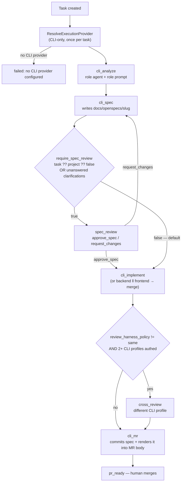

# Design: CLI-Only Execution

## Key Decisions

- **Decision:** Delete `pkg/llm` and its dependents outright; do not gate them behind a flag.
  **Reason:** A feature-flagged API path keeps every interface, mock and test alive and re-grows on the next feature. The point of the change is surface-area collapse, which a flag prevents by construction.

- **Decision:** Keep the HTTP server and dashboard.
  **Reason:** They are how humans drive the platform. "API mode" names how an *agent* reaches a model, an unrelated axis.

- **Decision:** Collapse the six-input auto-approval matrix to one boolean.
  **Reason:** The matrix optimized for "gate the risky things automatically" but produced behavior no operator could predict, and its risk detection was substring matching on paths (`role` matched `role_templates.go`). An unpredictable gate gets ignored; a predictable one gets used. The MR remains the enforced human boundary.

- **Decision:** Re-host `cross_review` on a second CLI profile rather than deleting it.
  **Reason:** Its value is harness *diversity* — a second model independently reviews the first's work. That property survives the API removal; only the mechanism (`llm.WithExcludeProviderID` on the provider router) has to move to profile exclusion.

- **Decision:** Raise the idle timeout's importance rather than just the wall clock.
  **Reason:** `DefaultIdleTimeout` (15m) fires long before any wall-clock cap on a stuck run, so the wall clock was never the real stall detector — it was only truncating *healthy* long runs. Raising it to 5h fixes the false positives without weakening stall detection.

- **Decision:** Drop only the vector stream from memory search.
  **Reason:** BM25 (`tsvector`, generated column) and the knowledge graph are pure Postgres and cost nothing to keep. Deleting working, API-free functionality to satisfy the letter of "remove API code" would be destruction without benefit.

## Approach

The change is overwhelmingly subtractive, and the safe order is **leaves inward**: delete the things nothing else depends on first, so the compiler continuously proves what is still reachable rather than leaving a half-migrated tree that neither builds nor tests.

Dependency depth, deepest first: `internal/tool` (nothing imports it but `prompts/builder.go`) → `orchestrator/llmrunner` → `orchestrator/steps` API-native steps → `internal/gateway` → `pkg/llm` → wiring in `cmd/api/main.go`. Workflow shapes are removed alongside the steps they reference, because `workflow.Definition` holds `StepFunc`s by ID and a dangling ID yields a nil runner at execution time rather than a compile error — the one place in this change where deletion fails silently. Phase 2 therefore deletes workflow builders and step constructors in the same commit and asserts the runner map is total.

The CLI simplification is then layered on the surviving pipeline as three independent slices — gate, MR content, timeouts — each shippable and verifiable on its own.

`ResolvedExecutionProvider` keeps its shape but loses its `Type` discriminator; `ResolveExecutionProvider` returns an error instead of an api-native fallback. This keeps the router's credential-selection, cooldown and pinning logic (all CLI-relevant) while removing only the arbitration that no longer has two sides.

## Alternatives Considered

**Feature-flag the API path (`ENABLE_API_EXECUTION=false`), delete later.**
Rejected: leaves 21k lines and all their tests alive, and "later" does not arrive. Also keeps the dual-engine cost on every subsequent change, which is the problem being solved.

**Keep `pkg/llm` for non-execution uses (embeddings, PR summaries).**
Rejected on inspection: `PRGenerator` turned out to be pure templating with no LLM call, and embeddings are the only real consumer. Keeping the entire provider/router/pricing/budget graph for one embedding call is the worst trade in the set — hence D4 deletes the vector stream instead.

**Keep the high-risk auto-gate alongside the new boolean.**
Rejected: it reintroduces the unpredictability the boolean exists to remove, and its pattern matching was demonstrably noisy. An org wanting it sets `require_spec_review = true` project-wide — a blunter but honest instrument.

**Make the 5-hour timeout configurable per project.**
Rejected as speculative (Golden Rule 5). One constant until a second value is actually needed.

**Run `cross_review` with the same harness when only one is authenticated.**
Rejected: a model reviewing its own output is review theater. Skipping with a logged reason is honest and visible.

## Architecture



## Interfaces & Contracts

**Gate resolution** — replaces `ShouldAutoApproveSpec`'s `(complexity, affectedFiles, riskDomains, agentAutonomy, projectAutonomy, projectReviewPolicy, hasClarifications) → (specStatus, taskStatus)`:

```go
// policy.RequiresSpecReview reports whether the run must pause at
// spec_review after cli_spec. The task-level override wins whenever set;
// otherwise the project default decides. Clarifications gate independently
// (see ResolveSpecGate) — an agent that asked a question is never answered
// by proceeding.
func RequiresSpecReview(task *models.Task, project *models.Project) bool

// ResolveSpecGate folds in the clarification path and returns the statuses
// cli_spec should write, keeping the single decision in one place.
func ResolveSpecGate(task *models.Task, project *models.Project,
    hasClarifications bool, priorRounds int) (specStatus, taskStatus string)
```

**Models:**
```go
// models.Task
RequireSpecReview *bool `json:"require_spec_review,omitempty" gorm:"column:require_spec_review"` // nil = inherit project

// models.Project
RequireSpecReview bool `json:"require_spec_review" gorm:"column:require_spec_review;not null;default:false"`
```

**Execution provider** — `Type` removed; construction is CLI-only:
```go
type ResolvedExecutionProvider struct {
    Ref          string // claude_code | openai_codex | antigravity | custom
    CredentialID string
    CLIConfig    *models.CLIEngineConfig
}
func (o *Orchestrator) ResolveExecutionProvider(...) (*ResolvedExecutionProvider, error) // error when none available
```

**MR body contract** — `PRSummary` gains a spec section rendered above the change summary:
```go
type SpecSection struct {
    Slug           string
    Goal           string
    KeyDecisions   []string
    VerifySteps    []string
    Clarifications []ClarificationNote // question + assumption proceeded on
    Missing        bool                // renders the ⚠️ no-spec notice
}
```
Parsed from the spec files on disk by the existing `TaskSpecSlug` path; `PRGenerator` stays template-only, no model call.

**Cross-harness selection:**
```go
// Picks an authenticated CLI profile different from the one that produced
// the code. Returns ok=false when no distinct profile is available, which
// callers must treat as "skip cross_review", never "review with the same".
func (r *cliStepRunner) resolveReviewProfile(ctx context.Context, task *models.Task,
    coderRef string) (cfg *models.CLIEngineConfig, credID string, ok bool)
```

**Timeouts:**
```go
// engine/cli.go
const defaultCLITimeout = 5 * time.Hour // was 3h
// models/cli_profiles.go — all three built-in profiles
TimeoutMinutes: 300 // was 30
// sandbox.DefaultIdleTimeout stays 15m — unchanged, deliberately
```

## Security Boundaries

- **Model credentials leave the server process.** With API keys gone, the only model auth is the CLI harness's own session inside the sandbox container, injected per-run by the existing credential-pool mount path. The server never holds a bearer token for a model provider — a net reduction in blast radius.
- **The 5-hour window widens the sandbox exposure per step.** Container isolation, the network policy and the workspace mount are unchanged; a compromised or runaway agent simply has longer to act. Accepted: the idle timeout and loop detector remain the active bounds, and the sandbox boundary itself is what contains it.
- **Auto-approval does not widen write access.** The agent's sandbox permissions are identical whether or not a human approved the spec; the only thing skipped is a read-only human checkpoint. Push and merge still require the MR and its reviewer.
- **Spec content is rendered into MR bodies**, which are visible to everyone with repo access. The spec is agent-authored from the task description and repo content — the same trust level as the diff it accompanies — but secrets redaction (`engine/redact.go`) must be applied to the rendered section as it already is to logs.

## Performance Considerations

- **Expected throughput:** unchanged; concurrency is bounded by sandbox slots, not by this change.
- **Latency budget:** N/A for the pipeline (agent runs dominate, minutes to hours). The added spec-parse-and-render at `cli_mr` is file I/O over a handful of markdown files, < 50ms.
- **Caching:** CLI Preflight caching per job (`cliStepRunner.preflightKey`) is unchanged and matters more now — `resolveReviewProfile` introduces a second candidate, which must not trigger a redundant auth-check container run for the coder profile.
- **Known bottleneck introduced:** a job now holds its sandbox slot for up to 5 hours instead of 30 minutes, so a queue of long tasks can starve short ones. Worth watching; not addressed here.
- **Removed:** all LLM API latency, retry and fallback cost from the server's critical path, along with per-tool-call round trips in `llmrunner`.

## Observability

### Metrics
- `task.spec_gate.required` — counter, labeled `source=task|project`. Should be near-zero after this ships; a spike means someone re-gated broadly.
- `cli.step.duration_seconds` — histogram by step and profile. The p99 is the evidence for whether 5h was the right cap.
- `cli.step.killed` — counter labeled `reason=timeout|idle_timeout|loop_detected`. `timeout` should stay rare; if it rises, the cap is masking a stall the idle detector misses.
- `cross_review.skipped` — counter labeled `reason=single_harness|policy_same`. Quantifies how often diversity is unavailable.
- `mr.spec_missing` — counter. Non-zero means `cli_spec` is silently producing nothing.

### Logging
- INFO at `cli_spec`: resolved gate with its source (`require_spec_review=false (project default)`), so the decision is never inferred from behavior.
- INFO at `cli_mr`: spec slug committed and whether the body section rendered.
- WARN: `cross_review skipped: only one CLI harness available`; `MR opened without OpenSpec`; clarification-round bypass.
- ERROR: provider resolution failure naming the project and what to configure.
- No model credentials or spec content at ERROR level; `engine/redact.go` applies to captured CLI output as today.

### Tracing
- Span `task.run` → child spans per step (`cli_analyze`, `cli_spec`, `cli_implement*`, `cross_review`, `cli_mr`), each tagged with profile ref and credential label. The `llmrunner` per-tool-call spans disappear with it — a real loss of granularity, accepted as the cost of treating the harness as a black box.

## Risks

| Risk | Mitigation |
|---|---|
| Deleted workflow step IDs leave nil runners in the map — fails at runtime, not compile time | Phase 2 asserts every `StepDefinition.ID` in every surviving workflow resolves to a non-nil `StepFunc`; a test walks all definitions |
| Auto-by-default lets a misread spec consume a full pipeline run | Spec ships in the MR (D8) so the miss is caught at review; `require_spec_review` available per task for known-ambiguous work |
| Orgs silently lose gating they relied on via `supervised` autonomy | Phase 0 pre-flight query lists affected projects; backfill preserves `always_review`; documented in the operator note |
| 5-hour cap lets a chatty stuck agent burn quota | Idle timeout (15m) and `loop_detector.go` unchanged and remain the active bounds |
| Long steps starve the sandbox queue | `cli.step.duration_seconds` p99 watched post-deploy; concurrency tuning is a follow-up if it materializes |
| `cross_review` re-host regresses review quality | Skip-rather-than-degrade rule; `cross_review.skipped` counter makes silent loss visible |
| Memory recall degrades after the vector stream is dropped | BM25 + graph retained; recall change is measurable via existing memory-search tests before/after |
| One-way migration destroys API credentials and usage history | Announced explicitly; operators export `token_usage` before deploy if they need the history (Phase 0) |
